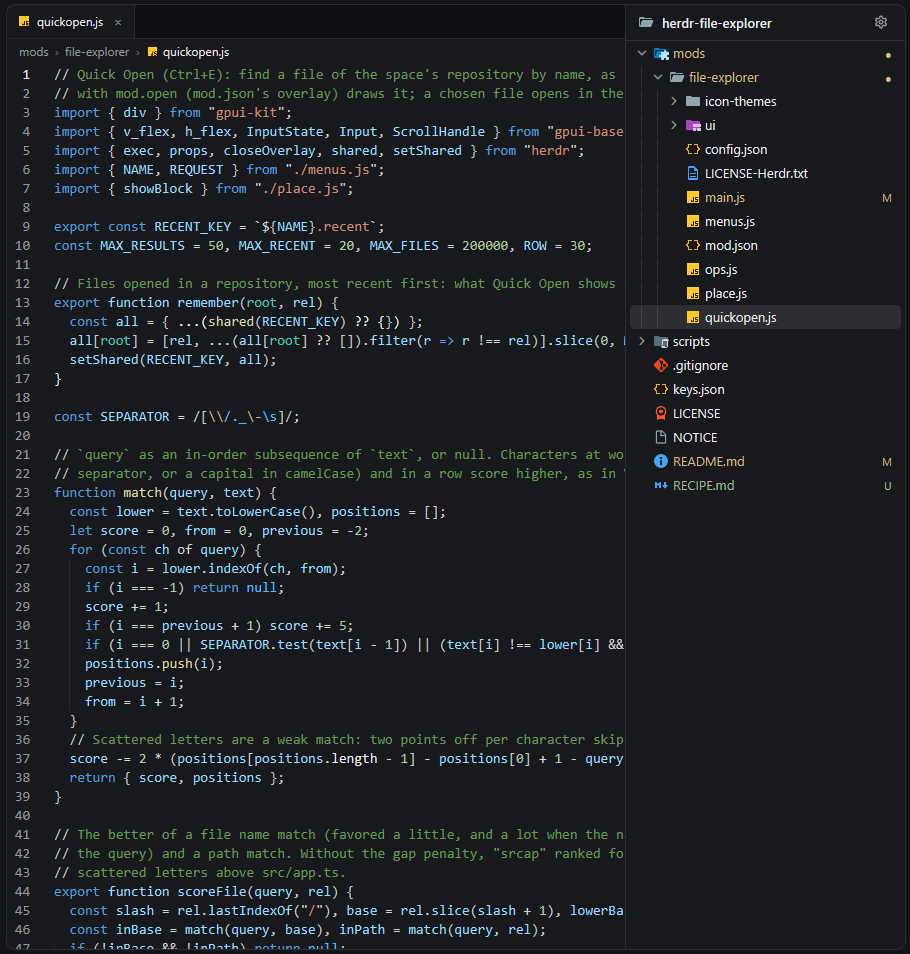

# Herdr File Explorer

An IDE-style file explorer for [Herdr](https://herdr.dev), in the right-hand panel: the space's
repository as a tree with file icons and git colors, editor tabs to read and edit files, find and
replace, search in folder and Quick Open.

## Use

**The tree**

- Click a folder to open it; click a file for a preview tab, double-click to keep it. Arrows,
  Home/End, Page Up/Down, Enter and Space work; typing jumps to a name; Escape returns to the terminal.
- **Git:** VS Code's letters and colors (U, A, M, D, C); folders holding changes get a dot; ignored
  files are dimmed.
- **Toolbar:** filter by name, show only pending changes, collapse every folder. The filters also
  find files in new folders never opened.
- **Right-click:** New File/Folder, Copy Path/Relative Path, Cut and Paste (moves), Rename (F2),
  Delete (to the Recycle Bin or Trash), Reveal in File Explorer, Open in Terminal, Find in Folder.
  `ctrl+z` in the tree undoes the last move or rename.
- **Drag** a file or folder onto a terminal to type its path, for example into an agent's prompt.

**Files**

- **Editing:** `ctrl+s` saves. A save never overwrites a change made meanwhile (by an agent): the tab
  offers Reload or Keep mine. Undo history survives switching spaces. Files on another machine are
  read-only.
- **Right-click in a file:** Copy Reference (`@path#5-10`, for an agent's prompt), paths, find, go to
  line, save. **Right-click a tab:** close it, the others, those to the right, the saved ones, or all.
- **Go to line** `ctrl+g`; **find** `ctrl+f` (match case, whole word, regex); **replace** `ctrl+h`:
  Enter replaces and moves to the next match, Replace All is undone by one `ctrl+z`.
- **Markdown:** the eye button shows a `.md` file rendered; its links open in tabs or the browser.

**Searching**

- **Search in folder:** `ctrl+shift+f`, Find in Folder…, or the Search tab at the bottom. It searches
  as you type (git grep, not ignored files), with match case, whole word, regex, and files to include
  or exclude (`*.{ts,tsx}, src/`).
- **Quick Open** (`ctrl-e`): any file of the repository by fuzzy name, recent files first.

**Look:** the gear menu picks the icons (Seti or Material), the syntax colors (VS Code's or the
Herdr theme's), and the editor font and size. The tree keeps the width you give it; opening a file
adds the editor beside it.

## Install

Needs Herdr 0.1.16 or newer.

**With an agent** (Herdr's usual way): in a terminal in Herdr, ask your coding agent:

> Read ~/.config/herdr-app/AGENTS.md, then add this mod: https://github.com/pascaltru/herdr-file-explorer

**By hand:**

1. Copy `mods/file-explorer` into `~/.config/herdr-app/mods/`, `mod.json` first (Herdr docks a new
   mod folder into the shown layout unless its `mod.json` is already there). On Windows,
   `scripts/install.ps1` does it and runs `herdr-app check`.
2. Put it in a layout. Herdr's own layouts are read-only, so clone yours first, for example
   `herdr-app do layout.clone '{"name":"main","as":"my-main"}'`, then make the right-hand panel's
   `files` block `"content": { "mod": "file-explorer" }`. Any block works.
3. Merge `keys.json` into `~/.config/herdr-app/keys.json`: `ctrl-shift-e` toggles the node `panel`
   (Herdr's `main` layout; use your node's id otherwise), replacing Herdr's split-down;
   `ctrl-e` opens Quick Open (terminal programs use it for end-of-line; End does the same).

Install defaults: `scripts/install.ps1 -IconTheme material -EditorFont <vscode|terminal|name>
-EditorFontSize <12-16>` (written to the installed `config.json`; the gear menu overrides them).

**What it runs:** `git` in the space's repository; on Windows `powershell` (folder listing, file
actions), elsewhere `sh`, `mv`, `mkdir` and `open`/`osascript` or `gio`/`xdg-open`. A web link in a
Markdown preview opens in the browser. It writes only when you save, create, rename, move or delete.
No network.

## Develop

Edit here, then run `scripts/install.ps1` to copy the mod into the Herdr home and check it.
`python scripts/build-icon-themes.py` regenerates `icon-themes/` from upstream at the versions pinned in
`icon-themes/versions.json` (`--material <version>` or `--vscode <tag>` to update one).

## License

MIT (`LICENSE`). Third-party parts keep their own licenses; see `NOTICE`.

## Credits

- Started from Herdr's shipped `files` mod (Apache-2.0); folder arrows from it, UI icons from Lucide.
- Seti icons: [seti-ui](https://github.com/jesseweed/seti-ui) by Jesse Weed (MIT), as shipped in VS Code;
  glyphs converted to SVG. See `icon-themes/seti/LICENSE-seti.txt`.
- Material icons: [Material Icon Theme](https://github.com/material-extensions/vscode-material-icon-theme) (MIT).
  See `icon-themes/material/LICENSE-material-icon-theme.txt`.
- Language table: [VS Code](https://github.com/microsoft/vscode) (MIT). See `icon-themes/LICENSE-vscode.txt`.
