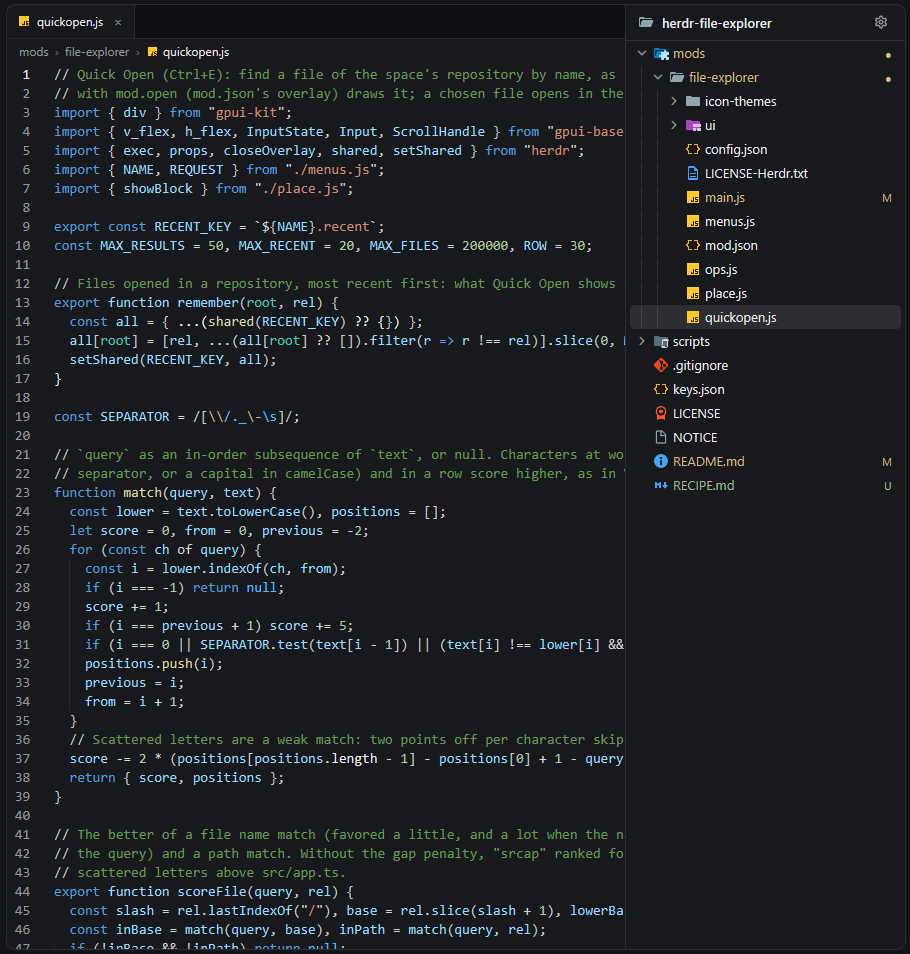

# File Explorer

An IDE-style explorer in Herdr's right-hand panel, like VS Code's. It shows the active space's
repository as a tree with file icons and git colors. Clicking a file opens it in editor tabs beside the
tree, where it can be edited and saved. Find and replace, search in folder and Quick Open come with it.

## What you see

- **Tree column** (the whole panel with no file open, on the right once files are open):
  - A 36px header: the repository's folder icon and name (semibold), a gear button (24px) on the right.
  - A toolbar: the "Filter in explorer" box (funnel icon), Pending changes and Collapse buttons.
  - Rows of 24px, 16px of indent per level, a 1px `border` indent guide per ancestor. Folders have a
    14px `muted` chevron. Each row: a 16px icon, the name, and on the right a git letter (11px) for
    files or `●` for folders holding changes.
  - Selected row: `selected` background, plus a 1px `accent` border while the tree has the keyboard.
    Hovered row: `hover`. Ignored entries: `dim`, icon at 50% opacity.
  - Over 500 entries in a folder: a note at the bottom, "Some folders show only their first 500 entries".
  - At the bottom, a 30px strip on `chrome` with two tabs, Explorer and Search. The shown one hangs
    from the panel on `background` (open at the top, `border` sides). Search is `dim` until a search ran.
- **Editor column**, left of the tree while files are open:
  - A 36px tab strip on `chrome`, level with the tree's header. Each tab: a 14px icon, the name (13px,
    in its git color; italic for a preview tab), a 22px close button (Lucide `x`, or `●` with unsaved
    edits). Active tab on `background`.
  - A 26px path row: folders in `muted` separated by `›`, then the file's icon and name; on the right,
    an eye button for Markdown files and the find magnifier.
  - Bars under it when open: go to line, find (and replace), "changed on disk".
  - The file in Herdr's code editor, with line numbers and folding, in VS Code's default font
    (Consolas 14 on Windows, Menlo 12 on macOS) at 1.35× line height (1.5× on macOS). Images are shown
    centered; a Markdown file can be shown rendered.
- **Git colors**, VS Code's letters: U untracked and A added in `ansi2`, M modified in `ansi3`, D deleted
  and C conflict in `ansi1`.
- **Find bar** (34px rows): the box (`accent` border, red with no match) with Match case `Aa`, Match
  whole word and Use regular expression toggles inside, then "3 of 14", ↑ ↓ and `×`. In editable files a
  chevron on the left opens a second row: a Replace box of the same width, Replace and Replace All.
- **Search view** (replaces the tree under the header): the box with the same three toggles and a `…`
  button that adds "files to include" and "files to exclude" boxes; a removable scope chip
  (`in src ×`); a summary ("4 results in 3 files") and Clear. Results grouped by file: a header
  (chevron, icon, name, folder, count), then each line with its number and the matches on `selection`,
  in the editor font, cut to 300 characters around the first match.
- **Gear menu** (280px popup): icon theme (Seti or Material), syntax colors (VS Code's Dark/Light Modern
  or the theme's), editor font (VS Code's, the terminal's or any installed monospace font, each in its
  own font, 5 rows then scrolling) and size (12 to 16).
- **Quick Open**: a 640px popup, 40px from the top, 60% of the window's height. An `accent`-bordered
  input; 30px rows: icon, name with matched letters in `accent` semibold, folder in `dim`.
- **Popups** at the pointer: tree right-click, a file's text (260px), a tab (240px); dialogs for delete,
  unsaved changes (460px) and moves.

## How it behaves

- **The tree** follows the active space: the repository of its terminal (git top level), else that
  folder. Each space keeps its own open folders, selection, tabs, filter and search.
- **Clicks and keys in the tree:** a folder opens or closes; a file opens a preview tab, which the next
  preview replaces; a double click keeps it. Up/Down, Page Up/Down, Home/End move; Right and Left open,
  enter, close or go to the parent; Enter opens and keeps a file; Space previews; letters jump to the
  next name starting with them; F2 renames; Delete deletes; Escape returns the keyboard to the terminal.
- **Toolbar:** the filter keeps files and folders whose name contains the text (case-insensitive), with
  the folders leading to them open; a folder matching only by name starts closed. Pending changes keeps
  entries with a letter or dot; it combines with the filter. Both find files inside untracked folders
  never opened, but not inside ignored ones. Collapse closes every folder shown. Escape clears the
  filter; Down or Enter moves to the first match.
- **Right-click** a file, folder or empty space: Open; New File…, New Folder… (named in place, at the
  top of the folder; an invalid name shows its reason); Copy Path, Copy Relative Path; Cut, Paste,
  Rename…, Delete; Reveal in File Explorer (Finder, Open Containing Folder); Open in Terminal; Find in
  Folder…. Another machine's spaces get only Open and the copies.
- **Moving:** Cut dims the row until Paste (Escape forgets it). Paste moves it into the folder, or beside
  a file; outside a repository a dialog asks first. Nothing moves into itself or over a taken name.
  Tabs, open folders and unsaved edits follow a move or rename. `ctrl+z` in the tree undoes the last
  20 moves and renames, newest first.
- **Delete** asks, then moves the entry to the Recycle Bin or Trash.
- **Dragging** a file or folder onto a terminal types its quoted path there, without Enter.
- **Tabs:** a click shows one, a double click keeps it, a middle click or `×` closes it. Right-click:
  Close, Close Others, Close to the Right, Close Saved, Close All (others close only saved tabs, with a
  toast saying how many were kept), Copy Path, Copy Relative Path.
- **Editing** (local files; another machine's are read-only):
  - Typing keeps a preview tab and shows `●`. `ctrl+s` saves, only if the file is still what the tab
    started from; otherwise the "changed on disk" bar offers Reload and Keep mine. A file changed on
    disk reloads when the tab has no unsaved edits, and shows the same bar when it has. CRLF files
    stay CRLF.
  - Closing a tab with unsaved edits asks "Save the changes to “name”?": Cancel, Don't Save, Save
    (Enter). Escape cancels.
  - Undo history, cursor and scroll survive switching spaces, renames and moves. Unsaved edits also
    survive a theme or font change, without their undo history.
- **Right-click in a file's text:** Cut, Copy, Paste; Copy Reference (`@path#5-10`, `#5` for one line,
  the bare path without a selection, with a toast); Copy Path, Copy Relative Path; Find in File, Go to
  Line…; Save.
- **Go to line** (`ctrl+g`): a line or `line:column`, Enter, and the cursor goes there, mid-editor.
  Anything else turns the box red. Escape closes.
- **Find** (`ctrl+f`, `F3` or the magnifier): a one-line selection fills the box.
  - Typing puts the first match after the cursor in the middle of the editor, not highlighted yet (the
    editor draws its selection only while it has the keyboard). Each letter searches again from where
    finding started.
  - Enter or `F3` selects the next match mid-editor and gives the editor the keyboard, so it shows;
    Shift goes back. Enter keeps stepping until a click or an edit in the text. In a read-only file,
    letters go back to the box.
  - Regular expressions are JavaScript's (`^` and `$` per line); whole word means no letter, digit or
    `_` on either side. Up to 10,000 matches; only the current one is highlighted.
- **Replace** (`ctrl+h` or the chevron; `ctrl+f` shows find alone):
  - Enter or Replace types the replacement over the match shown, then selects the next one with the
    editor holding the keyboard, so it shows; Enter keeps replacing until a click, a typed edit or a
    box taking the keyboard. With no match selected, the first press only shows the next one.
  - Replace All (`ctrl+alt+enter`) replaces every match; the count says "Replaced 12". One `ctrl+z`
    undoes it and leaves the cursor on the first match.
  - With regex, the replacement takes `$1`, `$&`, `$<name>`, `$$`. The count follows edits.
- **Markdown preview:** the eye shows a `.md` file rendered, unsaved edits included; `<>` goes back.
  The choice belongs to the tab. Relative and `file://` links inside the folder open in a preview tab
  (rendered if Markdown); `http`, `https` and `mailto` open in the browser; others do nothing. Find, go
  to line and search jumps switch back to the text. Relative images don't show.
- **Search in folder** (`ctrl+shift+f`, Find in Folder… for a scope, or the Search tab): searches
  tracked and untracked files, not ignored ones, as typing pauses (2 characters or more), on Enter, or
  when a toggle or file box changes. Regex accepts PCRE; an invalid one says "Invalid regular
  expression: <reason>". File boxes take comma-separated globs as VS Code reads them (`*.ts` at any
  depth, `src/lib` from the top, braces expand). A click, or arrows and Enter, opens the file at the
  match in a preview tab; a double click keeps it. A selected word fills the box. Clear keeps the
  toggles and file boxes. Repositories only.
- **Quick Open** (`ctrl-e`): recent files first; typing ranks every file by fuzzy match (word starts and
  runs score higher). Enter or a click opens the file in the panel and reveals it in the tree.
- **Panel width:** the tree keeps its width. The first file widens the panel by the editor (640px,
  then its last width), up to the layout's maximum; the line between them drags (200–1,200px); closing
  the last tab shrinks it back.
- **Live updates:** a change in the repository refreshes the tree and git colors within half a second,
  and open files reload. Outside a repository and on other machines it polls every 10 seconds. While
  hidden it does nothing, and catches up when shown.
- **`ctrl-shift-e`** shows or hides the panel; the tree takes the keyboard. Agent statuses change nothing.

## Built from

- **Layout:** a block `{ "content": { "mod": "file-explorer" } }`. In a clone of Herdr's `main` layout
  it replaces the `files` block (in the `panel-body` stack of the `panel` column). The mod finds its
  block by walking `layout()` to its own mod; to show it, it selects each stack on that path and shows
  hidden nodes; it resizes the nearest node on that path that sits in a row.
- **Files** in `mods/file-explorer/`: `main.js` (tree, editor, wiring), `menus.js` (popups and dialogs),
  `ops.js` (file actions), `find.js` (go to line, find, replace), `search.js` (Search view),
  `quickopen.js`, `place.js` (layout lookups), `icon-themes/` (Seti and Material, generated),
  `ui/` (Lucide icons), `config.json` (install defaults).
- **Popups:** the same mod opened with `openOverlay`; `props().menu` picks the popup, and with none it
  is Quick Open (`mod.open` with `mod.json`'s `overlay`). Popups ask the explorer through
  `setShared("file-explorer.request", …)`.
- **Herdr:**
  - functions: `spaces`, `panes`, `focused`, `layout`, `exec`, `readTextFile`, `writeTextFile`
    (with `expected`), `watchFolder`, `theme`, `settings`, `fonts`, `window`, `openOverlay`,
    `closeOverlay`, `shared`, `setShared`, `props`, `nextCommand`, `fs/promises` (its own files)
  - elements: `EditorState`/`Editor`, `TextView.markdown`, `h_resizable`, `v_virtual_list`
  - commands: `layout.resize`, `layout.select`, `layout.show`, `pane.focus`, `terminal.open`
  - shared state: `file-explorer.iconTheme`, `.syntax`, `.font`, `.fontSize`, `.recent`, `.request`
  - key bindings (`cx.bind_keys`, by key context): `ctrl-f`, `ctrl-h`, `ctrl-s` for
    `ExplorerEditor > Input`; `f2` for `ExplorerTree`; Enter for `FindStepping > Input` and
    `ReplaceStepping > Input`, contexts the editor area declares only while stepping
- **Programs:**
  - `git`: `rev-parse`; `ls-files -t -c -o --exclude-standard --directory` with `status --porcelain=v1
    --ignored=matching`, in parallel; `ls-files -o --exclude-standard` while a filter is on;
    `grep -n -I --null --untracked [-i] [-w] -F|-P|-E` with `:(glob)`, `:(glob,exclude)` and
    `:(literal)` pathspecs
  - Windows: `powershell` lists folders git doesn't describe and runs file actions (`New-Item`,
    `Rename-Item`, `Move-Item`, Recycle Bin through `Microsoft.VisualBasic`, `explorer /select`)
  - macOS and Linux: `sh` lists folders; `mkdir`, `mv`, `osascript`/`open` or `gio`/`xdg-open`
  - web links: `rundll32 url.dll,FileProtocolHandler`, `open` or `xdg-open`, the URL as an argument
  - no network
- **Syntax:** the editor's twelve colors (keyword, string, comment, function, type, number, constant,
  variable, operator, punctuation, boolean, string.escape). Missing languages use a close relative:
  TypeScript as JavaScript, PowerShell/Dockerfile/`.env` as shell, Terraform as Ruby, Kotlin as Java,
  Swift as Rust, Razor/Vue/Svelte as HTML, MSBuild as XML.
- **Art:** Seti glyphs converted to SVG (MIT), Material Icon Theme (MIT), Lucide (ISC);
  `scripts/build-icon-themes.py` regenerates the themes at pinned versions.

## Watch out

- **Drawing:** no `InputState.new` or `cx.focus_handle()` in a render; defer with
  `cx.timer.after(0, …)`; a finished `cx.spawn` drops its timers. Rows in a virtual list take no click
  handlers, so the tree draws its own absolute rows, wheel and scrollbar. Herdr drops pointer-leave
  events: hover comes from the pointer position on a 120ms timer.
- **Speed:** every redraw repaints the whole window; notify only when something shown changed, and skip
  the rebuild when git's output is unchanged. A regex per sort comparison costs ~130ms on 1,400 files:
  compute one key per name. PowerShell costs ~250–350ms to start: build the tree from git and read only
  ignored or untracked folders from disk, one level ahead. `fs.readdir` reads only inside the Herdr
  home (herdr-app#292).
- **Windows:** `watchFolder` reports `\\?\C:\…` paths; strip the prefix. Changes under `.git` must still
  refresh git colors. Run PowerShell with `$ErrorActionPreference = 'Stop'` and quote with
  `-LiteralPath` and doubled apostrophes (curly ones too).
- **Herdr's editor:**
  - It draws its selection only while it has the keyboard, and nothing else marks text: find can't
    highlight while its box has the keyboard, nor more than one match.
  - It scrolls only as far as a selection needs, for the last call in a frame: jumps select half a
    screen below, then above, frame by frame, to land mid-editor.
  - It keeps Ctrl+F (for a search it never shows), Ctrl+S, Enter and letters; `cx.bind_keys` with a key
    context wins over it. F2 is Herdr's tab rename; the tree's context wins there too.
  - Undo history can't be given back, so editors are kept per space (15 at most) rather than recreated.
  - `replace(text)` is one undo step and edits can't be grouped: Replace All types over the stretch
    from the first match to the last, and its undo selects that stretch (turned into a cursor).
  - `set_value` fires no change event.
- **`TextView`:** its own scrollbar, dragged, selects text; scroll it in a container instead.
- **The editor's right-click popup:** Herdr sends no "focus" when it closes; the popup's copy asks
  from its `close()`.
- **`git grep`:** `--literal-pathspecs` disables glob pathspecs, so the scope is `:(literal)`; git has
  no brace globs; `-P` needs PCRE (fall back to `-E`); `exec` can't be stopped, so searches queue.
- **Install:** Herdr docks a new mod folder into the shown layout unless `mod.json` (`"place": "none"`)
  arrives first.
- **Keys:** `ctrl-shift-e` replaces Herdr's split-down and toggles the node `panel`; `ctrl-e` takes
  end-of-line from terminal programs.
- **Limits:** 500 entries per folder; 200,000 paths from git; files over 1 MiB don't open
  (`readTextFile` refuses them, and the tab says so); other machines' spaces are polled, show no
  images and offer only read-only actions; unsaved edits are lost if Herdr quits or the mod reloads.

## Done when

- `herdr-app check mods/file-explorer` passes, and `herdr-app status` lists no errors.
- In a repository the tree shows tracked and untracked files; a modified file is yellow with `M`; an
  ignored folder is dimmed and lists its contents when opened.
- A click opens a preview tab, a second file replaces it, a double click keeps it. The panel widens,
  and narrows again when the last tab closes.
- Editing a file from a terminal turns it yellow within a second and updates its open tab; committing
  clears the color. Writing inside `node_modules` runs no git.
- Typing `chevron` in the filter shows `mods/file-explorer/ui/` open on the chevron icons. In a new
  untracked `a/b/c.txt`, typing `c.txt` shows `a › b › c.txt` open. Pending changes alone lists exactly
  `git status`'s files. Collapse leaves the top level.
- Dragging a file onto a terminal types its quoted path.
- `ctrl-e`, `mainjs`: `main.js` ranks first; Enter opens it and selects it in the tree.
- New File…, a name, Enter: the file appears in sort order. F2 renames. Del asks, then moves it to
  the Recycle Bin or Trash. Ctrl+X, then Ctrl+V on a folder moves it; Ctrl+Z moves it back.
- Typing shows `●`; `ctrl+s` saves and clears it. A change from a terminal meanwhile shows the
  "changed on disk" bar instead of reloading.
- Typing in a file, switching space and back: `ctrl+z` still undoes the typing.
- `ctrl+f`, a word, Enter: the next match is selected mid-editor, and "n of m" counts. `ctrl+g`, a line,
  Enter: the cursor goes there.
- `ctrl+h`, a word, a replacement: Enter replaces and shows the next match, Enter again replaces it;
  Replace All says "Replaced n", and one `ctrl+z` undoes it.
- The eye on `README.md` shows it rendered; a relative link opens that file.
- `ctrl+shift+f`, a word: results by file appear as typing pauses; a click opens the file at the match.
  Whole word, regex (`(?i)` too) and `*.{js,md}` in files to include narrow them.
- The gear menu switches icons, syntax colors, font and size live, keeping open tabs.
- Hiding the panel stops all refreshes; showing it catches up.
